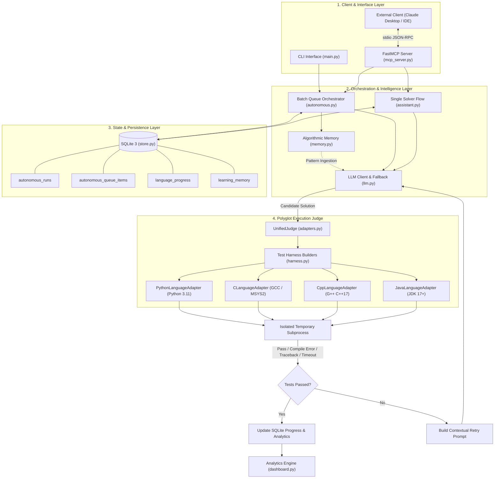

# LeetCode Agent 6.0: Multi-Language Autonomous Coding Agent & DSA Evaluation Engine

[](https://www.python.org/downloads/)
[](https://github.com/jagadesh-jpg/Leet-code-agent)
[](https://github.com/jagadesh-jpg/Leet-code-agent)
[](https://modelcontextprotocol.io/)
[](https://github.com/jagadesh-jpg/Leet-code-agent)

An autonomous multi-language coding agent with local compilation, test evaluation, diagnostic feedback, and persistent progress tracking.

LeetCode Agent autonomously formulates solutions, compiles and executes code locally across **Python, C, C++, and Java**, evaluates edge-case test harnesses, captures compiler/runtime diagnostics, and iteratively self-corrects until all tests pass—recording progress in SQLite and exposing real-time tool endpoints to AI agents, Claude Desktop, and developer IDEs.

---

## Table of Contents

- [1. Engineering Overview](#1-engineering-overview)
- [2. Problem Statement](#2-problem-statement)
- [3. Design Objectives](#3-design-objectives)
- [4. Implemented Capabilities](#4-implemented-capabilities)
- [5. System Architecture](#5-system-architecture)
- [6. Execution Lifecycle & System Workflow](#6-execution-lifecycle--system-workflow)
- [7. Module Responsibilities](#7-module-responsibilities)
- [8. Multi-Language Execution Architecture](#8-multi-language-execution-architecture)
- [9. Autonomous Solving & Feedback Loop](#9-autonomous-solving--feedback-loop)
- [10. Judge & Test Harness Architecture](#10-judge--test-harness-architecture)
- [11. Persistence & State Management](#11-persistence--state-management)
- [12. Model Context Protocol (MCP) Integration](#12-model-context-protocol-mcp-integration)
- [13. Security Architecture & Threat Considerations](#13-security-architecture--threat-considerations)
- [14. Error Handling, Reliability & Fallback Strategy](#14-error-handling-reliability--fallback-strategy)
- [15. Verification & Testing Strategy](#15-verification--testing-strategy)
- [16. Installation & Configuration Guide](#16-installation--configuration-guide)
- [17. Usage & CLI Reference](#17-usage--cli-reference)
- [18. Project Directory Structure](#18-project-directory-structure)
- [19. Limitations & Compliance](#19-limitations--compliance)
- [20. Roadmap](#20-roadmap)
- [21. License & Rights](#21-license--rights)
- [22. Author & Contact](#22-author--contact)

---

## 1. Engineering Overview

Modern Large Language Models (LLMs) generate plausible code snippets but lack deterministic verification mechanisms. When prompted with algorithmic problems, LLMs frequently emit syntax errors, off-by-one boundary failures, improper pointer handling, or unhandled recursion depths.

**LeetCode Agent 6.0** bridges generative artificial intelligence with local compiler toolchains. It implements an autonomous closed-loop evaluation system where candidate code is compiled, linked, executed against deterministic test suites, analyzed upon failure, and fed back into the reasoning loop for automated self-repair.

---

## 2. Problem Statement

Algorithmic coding benchmarks and AI assistants face three fundamental engineering hurdles:

1. **Unverified Generation**: Standard coding assistants provide passive generation. Without executing code against test cases, subtle logic regressions and syntax errors pass undetected to developers.
2. **Language Monoculture**: The overwhelming majority of code evaluation harnesses focus exclusively on interpreted Python. They fail to benchmark compiled languages that require manual memory management (C), strict object lifecycles (C++), or static type systems (Java).
3. **Manual Failure Triaging**: When an LLM fails a test case, engineers are forced to manually copy compiler logs or runtime stack traces back into chat windows. This friction slows evaluation and prevents scalable, automated DSA benchmarking.

---

## 3. Design Objectives

- **Polyglot Uniformity**: Provide consistent execution, evaluation, and diagnostic normalization across Python, C (C11), C++ (C++17), and Java (JDK 17+).
- **Zero-Credit Verifiability**: Provide an offline mock engine (`MockLLM`) that reproduces failure-diagnosis-repair loops locally with zero cloud API dependency.
- **Persistent State**: Isolate progress per language in a relational SQLite schema, ensuring runs can be paused, resumed, or recovered across process interruptions.
- **Protocol Openness**: Expose orchestrator capabilities through standardized FastMCP tools, allowing external agents (Claude Desktop, Cursor, Antigravity) to drive problem-solving programmatically.
- **Strict Anti-Scraping Compliance**: Adhere strictly to platform terms of service: zero unauthorized web scraping, zero cookie/credential storage, and zero automated external submissions to `leetcode.com`.

---

## 4. Implemented Capabilities

- **Autonomous Closed-Loop Repair**: Detects `compile_error`, `runtime_error`, `wrong_answer`, and `timeout`, extracting diagnostic context for structured multi-turn correction prompts.
- **Multi-Language Judge (`UnifiedJudge`)**: Auto-detects local compilers (MSYS2 UCRT64 GCC/G++, Clang, OpenJDK) and executes code in isolated subprocesses.
- **Complex DSA Test Harnesses**: Native code generators for Arrays, Strings, Singly-Linked Lists (`ListNode`), and Binary Trees (`TreeNode`) with automated tree deserialization.
- **Dual-LLM Rate-Limit Fallback**: Dynamic HTTP 429/503 quota diagnostics that detect transient versus daily exhaustion and automatically route requests to a configured secondary provider fallback.
- **Persistent Learning Memory**: Algorithmic pattern retrieval store (`learning_memory`) that indexes common DSA strategies (Two Pointers, Sliding Window, DP, Binary Search) and injects contextual heuristics into prompts.
- **Batch Dataset Validation**: CLI utility that validates bulk problem JSON files against local reference solutions using the test judge before database ingestion.
- **Personal Analytics Dashboard**: Tracks solve counts, attempt ratios, language breakdowns, and recommendations without double-counting manual LeetCode submissions.
- **15 Registered FastMCP Tools**: Full-featured server implementing problem listing, single solving, background queue management, verdict recording, and memory retrieval.

---

## 5. System Architecture

The following diagram illustrates the component interactions, execution boundaries, and feedback cycles:



---

## 6. Execution Lifecycle & System Workflow

The autonomous solving loop executes as a stateful, bounded state machine:

```
[Dispatch Problem]
       │
       ▼
[Retrieve Pattern Context] ──► Query `learning_memory` for relevant DSA heuristics
       │
       ▼
[Prompt Generation]       ──► Build language-specific prompt (syntax, signature, rules)
       │
       ▼
[LLM Candidate Code]      ──► Parse Markdown block & isolate raw source code
       │
       ▼
[Build Test Harness]      ──► Generate standalone runner wrapping test cases
       │
       ▼
[Subprocess Execution]    ──► Run in temporary directory with 10s timeout & output limits
       │
   ┌───┴───────────────────────┐
   ▼                           ▼
[Tests Passed]            [Execution Failed]
   │                           │
   │                           ▼
   │                      [Diagnose Verdict]
   │                      ├── compile_error : Extract compiler stderr
   │                      ├── runtime_error : Capture traceback / signal
   │                      ├── wrong_answer  : Capture input, expected, actual
   │                      └── timeout       : Flag infinite loop (>10s)
   │                           │
   │                           ▼
   │                      [Budget Check]
   │                      ├── Attempts Remaining? ──► [Build Retry Prompt] ──┐
   │                      └── Exhausted?          ──► [Mark Failed in DB]    │
   ▼                                                                         │
[Mark Locally Verified] ◄────────────────────────────────────────────────────┘
   │
   ▼
[Persist Language Progress & Advance Queue]
```

---

## 7. Module Responsibilities

| Module | Primary Responsibility |
| :--- | :--- |
| `main.py` | Command-line interface entry point supporting `--demo`, `--list-problems`, `--dashboard`, and `--autonomous`. |
| `autonomous.py` | Queue management, background worker threads, live pause/resume/stop signals, and interrupted run recovery. |
| `adapters.py` | `UnifiedJudge` router and concrete language adapters (`PythonLanguageAdapter`, `CLanguageAdapter`, `CppLanguageAdapter`, `JavaLanguageAdapter`). |
| `harness.py` | Standalone test runner code generators for Array, String, `ListNode` (linked list), and `TreeNode` (binary tree) across C, C++, and Java. |
| `languages.py` | Dynamic compiler detection on Windows/Linux (probing MSYS2 UCRT64 GCC, Clang, OpenJDK) and runtime environment configuration. |
| `judge.py` | Subprocess invocation harness for Python solutions with output boundary delimiters (`###RESULT_START###`), memory limits, and timeout enforcement. |
| `llm.py` | Dual-provider client (`LLMClient`) supporting OpenAI-compatible endpoints, API quota diagnosis (`parse_gemini_error`), automated rate-limit failover, credential sanitization (`sanitize_error_text`), and deterministic `MockLLM`. |
| `assistant.py` | Single-problem autonomous workflow, LeetCode URL validation, and automated time/space complexity analysis. |
| `memory.py` | Persistent algorithmic pattern memory retrieval, keyword extraction, and contextual prompt injection. |
| `dashboard.py` | Aggregates local language progress, parses manual CSV submission logs, identifies attempted-but-unsolved problems, and calculates recommendations. |
| `mcp_server.py` | FastMCP server exposing 15 standardized tools over `stdio` for AI agent environments. |
| `store.py` | SQLite 3 data access layer managing tables: `attempts`, `language_progress`, `custom_problems`, `official_verdicts`, `imported_submissions`, `learning_memory`, `autonomous_runs`, and `autonomous_queue_items`. |
| `prompts.py` | Language-specific system prompts, retry templates, complexity prompts, and code fence extractors. |
| `problems.py` | Built-in problem catalog loader, schema validator, and difficulty filtering. |
| `import_batch.py` | CLI batch importer that executes reference solutions against the local judge before writing problems to SQLite. |
| `demo_mock.py` | Standalone zero-credit multi-language demonstration runner using an ephemeral SQLite database. |

---

## 8. Multi-Language Execution Architecture

To support true polyglot evaluation without forcing non-Python languages into artificial Python bindings, the engine uses **native compilation and execution**:

### 1. Python 3 (`PythonLanguageAdapter`)
- Executes via subprocess with 10s timeout enforcement and output truncation (with POSIX memory guards where supported).
- Supports both standalone functions and LeetCode `class Solution` patterns.
- Serializes results via structured JSON markers (`###RESULT_START###` / `###RESULT_END###`).

### 2. C Language (`CLanguageAdapter`)
- Compiles native C code using `gcc -O2 -o solution.exe` (or MSVC `cl.exe`).
- Generates pure C test runners adhering to LeetCode signatures with explicit array sizes and pointer-to-pointer return arguments (e.g. `int* twoSum(int* nums, int numsSize, int target, int* returnSize)`).
- Dynamically allocates and deep-compares `struct ListNode` and `struct TreeNode` hierarchies, with automatic `free()` memory cleanup.

### 3. C++ (`CppLanguageAdapter`)
- Compiles candidate `class Solution` implementations using `g++ -std=c++17 -O2 -o solution.exe`.
- Provides native STL headers (`<vector>`, `<string>`, `<unordered_map>`, `<algorithm>`) and test harness comparators.

### 4. Java (`JavaLanguageAdapter`)
- Compiles `class Solution` into an ephemeral class directory using `javac Solution.java`.
- Executes tests using `java -cp . TestRunner`, parsing structured result codes and capturing compiler/runtime exceptions.

---

## 9. Autonomous Solving & Feedback Loop

The self-correction mechanism avoids blind retries by building **structured diagnostic prompts**:

1. **Failure Discrimination**:
   - **Compile Failure**: Feeds compiler stderr diagnostics back into the model with explicit instructions to resolve syntax, type mismatches, or missing imports.
   - **Wrong Answer**: Injects the failing input arguments, the expected output, and the actual candidate output.
   - **Runtime Error**: Captures stack traces, null-pointer dereferences, or segmentation faults.
   - **Timeout**: Flags potential infinite loops or suboptimal time complexity ($O(2^n)$ vs $O(n \log n)$).
2. **Context Window Efficiency**: Diagnostic messages and compiler logs are capped at 1,500 characters, preserving token budget while delivering actionable error context.
3. **Attempt Boundedness**: Runs enforce `--max-attempts` (default: 5) per problem. If exhausted, the item transitions to `failed`, preventing runaway API billing.

---

## 10. Judge & Test Harness Architecture

To evaluate complex data structures without manual boilerplate, `harness.py` dynamically injects test runners:

### Singly-Linked Lists (`ListNode`)
- Deserializes flat JSON arrays (e.g. `[1, 2, 3, 4, 5]`) into linked node structures.
- Traverses and executes the user's function.
- Serializes the resulting chain back into array form for equality verification, checking for circular reference traps.

### Binary Trees (`TreeNode`)
- Level-order (breadth-first) array deserialization supporting `null` nodes (e.g. `[3, 9, 20, null, null, 15, 7]`).
- Traverses tree roots, measures depth or tree mutations, and releases allocated heap memory recursively.

---

## 11. Persistence & State Management

State is managed through SQLite 3 (`progress.db`) with relational tables:

```
┌────────────────────────────────────────────────────────────────────────┐
│                              SQLite 3 Schema                           │
├────────────────────────────┬───────────────────────────────────────────┤
│ Table                      │ Purpose                                   │
├────────────────────────────┼───────────────────────────────────────────┤
│ `attempts`                 │ Full log of every attempt, code, status.  │
│ `language_progress`        │ Isolated solve/fail status per language.  │
│ `custom_problems`          │ Imported problems, signatures, tests.     │
│ `official_verdicts`        │ Manual official benchmarks (ms, MB).      │
│ `imported_submissions`     │ Historical CSV submission logs.           │
│ `learning_memory`          │ Algorithmic heuristics and strategy tips. │
│ `autonomous_runs`          │ Run lifecycle, budgets, and checkpoints.  │
│ `autonomous_queue_items`   │ Ordered problem queue for batch worker.   │
└────────────────────────────┴───────────────────────────────────────────┘
```

**Language Isolation**: Solving a problem in Python does **not** mark it solved in C++ or Java. Each language maintains its own independent verification state.

---

## 12. Model Context Protocol (MCP) Integration

LeetCode Agent exposes **15 standard FastMCP tools** over `stdio` in `mcp_server.py`:

| Tool Name | Parameters | Description |
| :--- | :--- | :--- |
| `list_problems` | `difficulty` | Lists available curated and imported problems with solve state. |
| `get_problem` | `problem_id` | Retrieves problem statement, signature, and example tests. |
| `submit_solution` | `problem_id, code` | Judges code locally and logs attempt in SQLite. |
| `get_progress` | None | Returns progress metrics, custom imports, and official verdicts. |
| `import_problem` | `url, title, difficulty, description, ...` | Ingests a new problem statement without scraping. |
| `solve_problem` | `problem_id, max_attempts` | Solves a single problem autonomously with complexity analysis. |
| `record_verdict` | `problem_id, verdict, runtime_ms, memory_mb, notes` | Records official manual LeetCode benchmarks. |
| `import_csv_submissions` | `csv_path_or_content` | Bulk-imports historical submission CSVs. |
| `get_dashboard` | `username` | Computes aggregated statistics, recent attempts, and recommendations. |
| `start_autonomous_run` | `max_problems, max_attempts, difficulty, language, budget` | Launches background batch queue solving. |
| `get_run_status` | `run_id` | Inspects live run progress, attempt counters, and queue state. |
| `pause_autonomous_run` | `run_id` | Safely signals worker to pause after current attempt. |
| `resume_autonomous_run` | `run_id` | Resumes an interrupted run from its saved checkpoint. |
| `stop_autonomous_run` | `run_id` | Terminates an active background batch run cleanly. |
| `get_learning_memory` | `category, limit` | Retrieves persistent algorithmic heuristics and tips. |

### Configuration (`mcp_config.json`)
To connect LeetCode Agent to Claude Desktop, Cursor, or Antigravity IDE, add an entry to your client's MCP configuration file, replacing `<repository-directory>` with the absolute path to your local clone:

```json
{
  "mcpServers": {
    "leetcode-agent": {
      "command": "python",
      "args": ["mcp_server.py"],
      "cwd": "<repository-directory>"
    }
  }
}
```

> [!NOTE]
> Ensure `<repository-directory>` points to your local project root where `mcp_server.py` resides. If Python is installed in a virtual environment, supply the full path to `python` or `python.exe` inside that environment.

---

## 13. Security Architecture & Threat Considerations

### Secret Protection & Redaction
- **Credential Exclusion**: `.env` and credential file patterns (`*.key`, `*.pem`, `*.cert`, `credentials.json`) are configured in `.gitignore` to prevent accidental commits.
- **Active Stream Sanitization**: `sanitize_error_text()` scans error streams and terminal outputs to mask detected:
  - Google Gemini API keys (`AIza...`)
  - OpenAI API keys (`sk-...`)
  - GitHub Personal Access Tokens (`ghp_...`, `github_pat_...`)
  - AWS Access Keys (`AKIA...`)
  - Bearer tokens and credential URL parameters (`password=`, `key=`, `token=`).
- **Synthetic Test Fixtures**: All unit tests use explicit mock strings (`AIza_FAKE_TEST_KEY_FOR_UNIT_TESTING_ONLY`) to prevent false positives in GitHub Push Protection or CI secret scanners.

### Subprocess Execution Boundaries
> [!WARNING]
> **Local Subprocess Notice — Not an OS Hypervisor Sandbox**:
> Candidate solutions execute via native OS processes (`python.exe`, `gcc`-compiled `solution.exe`, `java.exe`).
> - **Protections**: Executions run inside isolated temporary directories (`tempfile.TemporaryDirectory`), enforce subprocess execution timeouts (default 10s across all language adapters and compilation steps), truncate captured diagnostic output to 1,500 characters, and redirect stdin to `DEVNULL` (Python judge).
> - **Boundary**: This design prevents accidental infinite loops and runaway processes during personal development. Output is truncated post-capture rather than hard-capped at the OS pipe level. It is **not** a kernel-isolated container (e.g. gVisor or Docker seccomp). Do not execute untrusted or adversarial code from external networks outside a containerized environment.

---

## 14. Error Handling, Reliability & Fallback Strategy

1. **Dual-LLM Rate Limit Failover**: If the primary LLM provider returns HTTP 429 (quota or rate limits) or HTTP 503, `llm.py` automatically routes the request to the configured secondary provider (`LLM2_*`).
2. **Graceful Checkpointing**: If all providers exhaust their quotas or if the process receives a termination signal (`Ctrl+C` or `stop_autonomous_run`), the queue worker persists its state in `autonomous_runs` and cleanly sets status to `paused` or `interrupted`.
3. **Completed Run Safeguards**: `resume_autonomous_run()` validates run states and rejects attempts to restart runs already marked `completed` or `stopped`.

---

## 15. Verification & Testing Strategy

The repository includes a comprehensive 15-suite automated test matrix verifying judge isolation, compiler harnesses, MCP tool contracts, rate-limit diagnostics, and database transactions:

```powershell
.\.venv\Scripts\python.exe -m pytest -q
```

**Verified Test Result**:
```text
80 passed in 156.23s (0:02:36)
```

- **Test Isolation**: Test suites execute against isolated temporary databases (`tmp_path`) or mock fixtures, keeping production `progress.db` and official submission history intact.
- **Offline Determinism**: Tests use synthetic test doubles (`MockLLM`, `MockAPIException`), requiring zero external network calls.

---

## 16. Installation & Configuration Guide

### 1. Prerequisites
- **Python**: 3.10+ (tested on Python 3.11.9)
- **Windows PowerShell** or Linux/macOS Bash
- *(Optional for C/C++)*: [MSYS2](https://www.msys2.org/) with UCRT64 GCC toolchain
- *(Optional for Java)*: [OpenJDK 17+](https://adoptium.net/)

### 2. Setup Virtual Environment
```powershell
python -m venv .venv
.\.venv\Scripts\Activate.ps1
pip install -r requirements.txt
```

### 3. Environment Configuration

The agent integrates with external language-model services through a dedicated client layer. Credentials and private configuration are managed locally and should never be committed to version control. Offline demonstration and mock execution are available without API credentials.

To use live LLM capabilities, copy the local configuration template:
```powershell
Copy-Item .env.example .env
```

Refer to `.env.example` to review the required environment keys and configure your `.env` privately with your chosen provider. Never commit or share your `.env` file.

> [!TIP]
> You can run the entire system offline using `--demo` or `--mock` without configuring any API keys.

---

## 17. Usage & CLI Reference

### 1. Offline 4-Language Demonstration
Executes an end-to-end solve-fail-repair-pass cycle across Python, C, C++, and Java in an isolated temporary database:
```powershell
.\.venv\Scripts\python.exe main.py --demo
```

### 2. Problem Catalog & Solved Status
Displays a tabular overview of all curated and custom problems:
```powershell
.\.venv\Scripts\python.exe main.py --list-problems
```

### 3. Analytics Dashboard
Inspect solved tallies by language, submission counts, and active worker state:
```powershell
.\.venv\Scripts\python.exe main.py --dashboard
```

### 4. Autonomous Queue (Offline / Mock Mode)
Run the batch solver across queued problems without consuming API credits:
```powershell
# Python
.\.venv\Scripts\python.exe main.py --autonomous --mock --max-problems 2

# C++
.\.venv\Scripts\python.exe main.py --autonomous --mock --language cpp --max-problems 1

# Java
.\.venv\Scripts\python.exe main.py --autonomous --mock --language java --max-problems 1
```

### 5. Autonomous Queue (Live LLM Mode)
```powershell
.\.venv\Scripts\python.exe main.py --autonomous --language python --difficulty easy --max-problems 3
```

### 6. Batch Ingest Custom Problem Datasets
Validate and import problem sets with reference solutions:
```powershell
.\.venv\Scripts\python.exe import_batch.py problems_batch_example.json
```

---

## 18. Project Directory Structure

```text
Leet-code-agent/
│
├── main.py                          # CLI entry point (--demo, --dashboard, --list-problems, --autonomous)
├── autonomous.py                    # Autonomous batch queue orchestrator & thread lifecycle management
├── adapters.py                      # UnifiedJudge & language adapters (Python, C, C++, Java)
├── harness.py                       # Native test harness builders (Array, String, ListNode, TreeNode)
├── languages.py                     # Compiler auto-detection & environment PATH configuration
├── judge.py                         # Subprocess execution judge with timeouts and memory limits
├── llm.py                           # LLMClient (primary & fallback), quota handler, and MockLLM
├── assistant.py                     # Single-problem solve flow, validation, and complexity analysis
├── memory.py                        # Persistent learning memory retrieval & algorithmic heuristics
├── dashboard.py                     # Analytics engine, CSV import parser, and recommendations
├── mcp_server.py                    # FastMCP server exposing 15 tools over stdio
├── store.py                         # SQLite storage layer (runs, attempts, language_progress, memory)
├── prompts.py                       # Multi-language prompts, retry templates, and code extraction
├── problems.py                      # Curated problem dataset loader and difficulty filters
├── import_batch.py                  # Batch problem JSON importer with local judge verification
├── demo_mock.py                     # Standalone offline multi-language demonstration runner
│
├── problems.json                    # 9 Curated core problems (Easy, Medium, Hard)
├── problems_batch_example.json      # Reference template for batch problem imports
├── problems_batch_my10.json         # 10 Curated Easy problems with 4-language signatures
├── problems_batch_medium10.json     # 10 Curated Medium problems with 4-language signatures
│
├── tests/                           # 15 Automated test suites (80 passing tests)
│   ├── test_autonomous.py           # Queue execution, pause/resume, multi-language solve tests
│   ├── test_dashboard.py            # Dashboard analytics, language progress, and CSV deduplication
│   ├── test_import_batch.py         # Batch problem validation and schema rejection tests
│   ├── test_judge.py                # Judge execution, timeouts, syntax errors, and nested list comparison
│   ├── test_languages.py            # Compiler availability and adapter execution tests
│   ├── test_lang_isolation.py       # Independent language progress verification
│   ├── test_linked_lists.py         # ListNode test harness verification (Python, C, C++, Java)
│   ├── test_trees.py                # TreeNode test harness verification (Python, C, C++, Java)
│   ├── test_llm_diagnostics.py      # Error sanitization and backup client rate-limit fallbacks
│   ├── test_rate_limits.py          # Quota category parsing and pause on exhaustion
│   ├── test_mcp_server.py           # FastMCP tool contract and parameter tests
│   ├── test_assistant.py            # URL validation and single-problem solve flow
│   ├── test_mock_llm.py             # MockLLM multi-language and retry simulation tests
│   └── test_problems.py             # Dataset integrity and difficulty filtering
│
├── requirements.txt                 # Project dependencies (openai, mcp, pytest, python-dotenv)
├── .env.example                     # Environment template without credentials
└── .gitignore                       # Git exclusion rules (*.db, .env, build binaries, scratch files)
```

---

## 19. Limitations & Compliance

- **No Web Scraping**: The agent does not crawl or scrape `leetcode.com`. Problem definitions are loaded from local datasets or manual input.
- **Local Verification vs Official Acceptance**: A verdict of `locally_verified` indicates that code passed all local test cases in the test harness; it does not constitute official LeetCode submission acceptance.
- **Subprocess Execution**: Local execution is designed for developer benchmarking. It should be enclosed in a containerized environment before exposing to untrusted network clients.

---

## 20. Roadmap

- [ ] **Containerized Judge**: Enclose `UnifiedJudge` execution in lightweight Linux containers (`Docker` / `gVisor`) for secure multi-tenant deployments.
- [ ] **Rust & Go Adapters**: Extend `BaseLanguageAdapter` to support Rust (`cargo test`) and Go (`go test`).
- [ ] **Local Model Support**: Pre-configured integration with Ollama and vLLM for zero-cost local LLM inference.
- [ ] **Interactive Web UI**: Next.js / React web dashboard connecting to the FastMCP server over SSE.

---

## 21. License & Rights

All Rights Reserved. Copyright (c) 2026 Jagadesh.
This source repository is made publicly viewable for portfolio demonstration, educational review, and technical inspection. Unauthorized commercial distribution or re-licensing without prior written permission is prohibited.

---

## 22. Author & Contact

**Jagadesh**
- **GitHub**: [@jagadesh-jpg](https://github.com/jagadesh-jpg)
- **Repository**: [https://github.com/jagadesh-jpg/Leet-code-agent](https://github.com/jagadesh-jpg/Leet-code-agent)
- **LeetCode Profile**: [jagadesh-02](https://leetcode.com/u/jagadesh-02/)
