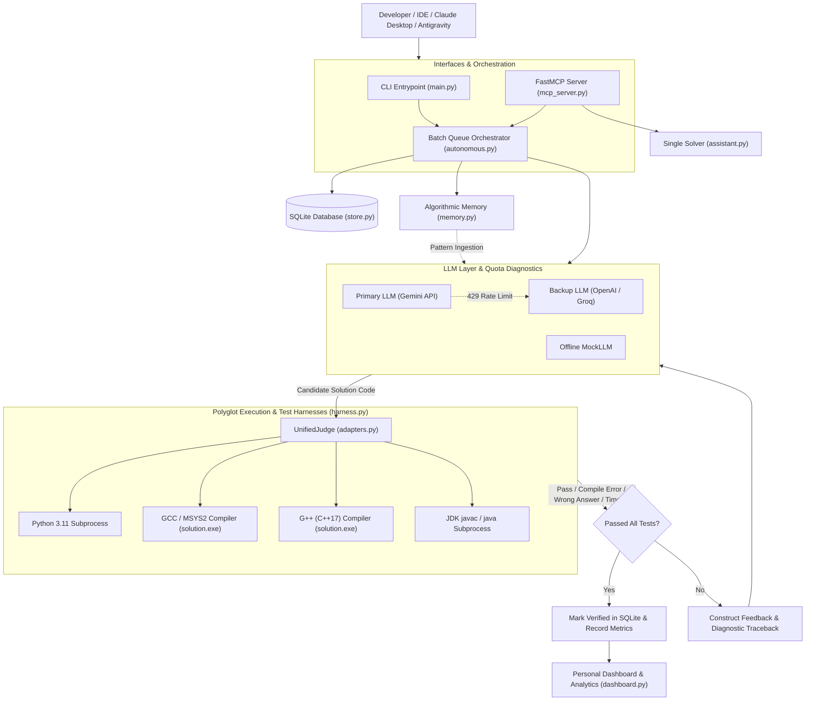

# LeetCode Agent 6.0: Multi-Language Autonomous Coding Agent & DSA Engine

[](https://www.python.org/downloads/)
[](https://github.com/jagadesh-jpg/Leet-code-agent)
[](https://github.com/jagadesh-jpg/Leet-code-agent)
[](https://modelcontextprotocol.io/)

An autonomous multi-language algorithmic problem-solving engine, isolated execution judge, persistent algorithmic memory, and Model Context Protocol (MCP) server.

LeetCode Agent autonomously formulates solutions, compiles and executes code locally across **Python, C, C++, and Java**, evaluates edge-case test harnesses, extracts compiler and runtime diagnostics, and iteratively self-corrects until all tests pass—benchmarking progress in SQLite and exposing real-time analytics to LLMs and developer IDEs.

---

## The Problem It Solves

Practicing Data Structures & Algorithms (DSA) or evaluating LLM code generation typically suffers from three major bottlenecks:

1. **Passive Generation Without Execution**: Most AI coding assistants generate code snippets but cannot verify correctness, leaving syntax errors, off-by-one bugs, and edge-case failures undetected.
2. **Language Monoculture**: Most coding benchmarks are restricted to Python, failing to test or debug language-specific idioms such as manual pointer manipulation in C, container lifecycles in C++, or object references in Java.
3. **Fragile Iteration Loops**: When an LLM produces a `Wrong Answer` or `Compile Error`, developers must manually copy-paste errors back and forth. LeetCode Agent closes this loop autonomously with bounded attempt budgets, persistent learning memory, and fault recovery.

---

## Key Features

- **Autonomous Solve-Judge-Fix Loop**: Iterative feedback cycle where candidate solutions are executed, diagnosed on failure (`compile_error`, `runtime_error`, `wrong_answer`, `timeout`), and corrected using previous attempt context.
- **Polyglot Execution (`UnifiedJudge`)**: Full support for **Python 3**, **C (C11)**, **C++ (C++17)**, and **Java (JDK 17+)** with compiler auto-detection for GCC/MSYS2, Clang, and javac.
- **Data Structure Test Harnesses**: Native code generators for Arrays, Strings, Linked Lists (`ListNode`), and Binary Trees (`TreeNode`) across all four languages.
- **Persistent Algorithmic Memory**: Vector-like pattern store that indexes algorithmic strategies (Two Pointers, Sliding Window, DP, Trees, Graphs) and injects contextual lessons into prompts before code generation.
- **Fault-Tolerant Queue Management**: Background worker threads with live `pause`, `resume`, `stop`, and checkpoint recovery after process interruptions.
- **Dual-LLM Rate Limit Fallback**: Built-in HTTP 429/503 quota diagnostics that automatically switch between primary (Gemini) and secondary (OpenAI-compatible) providers.
- **15 Registered FastMCP Tools**: First-class Model Context Protocol integration enabling Anthropic Claude Desktop, Cursor, or Antigravity IDE to invoke the solver and query progress via standard tool calls.
- **Personal LeetCode Analytics Dashboard**: Deduplicated tracking of local problem verifications alongside manual official LeetCode submission history.
- **Zero-Credit Offline Demonstration**: Full simulation mode (`--demo`) exercising the 4-language failure-and-correction workflow without external API calls.
- **Batch Problem Importer**: Validates JSON problem definitions against local reference solutions before ingesting them into the database.

---

## Architecture



---

## Step-by-Step Autonomous Workflow

1. **Problem Dispatch**: The agent loads curated problems (`problems.json`) or custom imported problems (`store.py`), prioritizing unsolved problems in the selected language.
2. **Context Enrichment**: Algorithmic memory retrieves relevant heuristics and pitfalls based on problem tags and descriptions.
3. **Generation**: The LLM receives a language-specific system prompt requesting raw, syntactically idiomatic code (e.g. `class Solution` for Java/C++, standalone functions with explicit sizes for C).
4. **Sandboxed Compilation & Execution**: The `UnifiedJudge` generates an isolated test harness in a temporary directory, applies memory limits and a strict 10-second timeout, and executes against the test cases.
5. **Verdict & Diagnosis**:
   - **`passed`**: Marked locally verified in SQLite (`language_progress`).
   - **`compile_error` / `runtime_error` / `wrong_answer`**: Stderr, stdout, and failing test inputs are captured and formatted into a structured retry prompt.
6. **Self-Correction Loop**: The agent attempts fixes up to `--max-attempts`. If the model exhausts its attempt budget or hits API limits, the run safely checkpoints its state for future resumption.

---

## Technology Stack

| Layer | Technologies & Tools |
| :--- | :--- |
| **Runtime & Core** | Python 3.11, PowerShell, Windows MSYS2 UCRT64 toolchain |
| **Language Toolchains** | GCC (C11), G++ (C++17), OpenJDK 17+ (`javac`, `java`), Python 3.11 |
| **LLM Protocols** | OpenAI-compatible Client, Google Gemini API, Custom Multi-Language `MockLLM` |
| **Agent Protocols** | FastMCP (Model Context Protocol) over stdio |
| **Database & State** | SQLite 3 (`store.py`) with thread-safe connection pooling and WAL mode |
| **Testing & Quality** | `pytest`, `pytest-mock`, isolated `tmp_path` fixture databases |

---

## Installation (Windows PowerShell)

### 1. Clone the Repository
```powershell
git clone https://github.com/jagadesh-jpg/Leet-code-agent.git
Set-Location -Path "Leet-code-agent"
```

### 2. Set Up Virtual Environment
```powershell
python -m venv .venv
.\.venv\Scripts\Activate.ps1
pip install -r requirements.txt
```

### 3. Optional Multi-Language Compiler Setup
- **Python**: Included with virtual environment.
- **Java**: Install [OpenJDK 17+](https://adoptium.net/) and ensure `javac` and `java` are available on your `PATH`.
- **C & C++**: Install [MSYS2](https://www.msys2.org/) with UCRT64 toolchain:
  ```powershell
  # Inside MSYS2 terminal:
  pacman -S mingw-w64-ucrt-x86_64-gcc
  ```
  The compiler adapter automatically searches `C:\msys64\ucrt64\bin\gcc.exe` and `g++.exe`.

---

## Configuration

Copy `.env.example` to create your private `.env` file:

```powershell
Copy-Item .env.example .env
```

Edit `.env` with your API credentials (this file is ignored by Git and never committed):

```ini
# Primary Provider (e.g. Google Gemini via OpenAI-compatible endpoint)
LLM_BASE_URL=https://generativelanguage.googleapis.com/v1beta/openai/
LLM_API_KEY=your_gemini_api_key_here
LLM_MODEL=gemini-2.5-flash

# Optional Secondary Backup Provider (Automatic fallback on 429/503 rate limits)
LLM2_BASE_URL=https://api.openai.com/v1
LLM2_API_KEY=your_backup_api_key_here
LLM2_MODEL=gpt-4o-mini

LLM_DELAY_SECONDS=4
JUDGE_TIMEOUT_SECONDS=10
```

> [!NOTE]
> You can run the entire system offline using `--mock` or `--demo` without providing any API keys.

---

## Usage Commands

### 1. Run Offline 4-Language Demonstration
Runs an end-to-end failure-and-correction demonstration across **Python, C, C++, and Java** using a temporary isolated SQLite database:
```powershell
.\.venv\Scripts\python.exe main.py --demo
```

### 2. View Problem Catalog & Solved Status
Displays a formatted status table of all curated and custom imported problems:
```powershell
.\.venv\Scripts\python.exe main.py --list-problems
```

### 3. View Analytics Dashboard
Inspect tracked submissions, solved tallies per programming language, attempt distributions, and active worker statuses:
```powershell
.\.venv\Scripts\python.exe main.py --dashboard
```

### 4. Run Autonomous Batch Solving (Mock / Offline Mode)
Run the autonomous solver sequentially across queued problems without burning API credits:
```powershell
# Python
.\.venv\Scripts\python.exe main.py --autonomous --mock --max-problems 2

# C++
.\.venv\Scripts\python.exe main.py --autonomous --mock --language cpp --max-problems 1

# Java
.\.venv\Scripts\python.exe main.py --autonomous --mock --language java --max-problems 1
```

### 5. Run with Live LLM (Gemini / OpenAI)
```powershell
.\.venv\Scripts\python.exe main.py --autonomous --language python --difficulty easy --max-problems 3
```

### 6. Batch Import Custom Problem Datasets
Ingest and validate new problems with reference solutions through the local judge:
```powershell
.\.venv\Scripts\python.exe import_batch.py problems_batch_example.json
```

---

## Model Context Protocol (MCP) Integration

The project exposes **15 standard FastMCP tools** over `stdio` in [mcp_server.py](file:///D:/Leet_code/mcp_server.py), allowing any MCP client (Claude Desktop, Antigravity IDE, Cursor) to control the agent:

| MCP Tool Name | Description |
| :--- | :--- |
| `list_problems` | Returns problem catalog filtered by difficulty and solved state. |
| `get_problem` | Returns problem description, signature, and example tests. |
| `submit_solution` | Evaluates Python candidate code against the local judge and records attempts. |
| `get_progress` | Returns solved tallies, custom imports, and manual official verdicts. |
| `import_problem` | Ingests a new problem statement with test cases manually. |
| `solve_problem` | Invokes single-problem autonomous workflow with complexity analysis. |
| `record_verdict` | Logs official manual submission benchmarks (runtime ms, memory MB). |
| `import_csv_submissions` | Bulk imports manual submission history from CSV files. |
| `get_dashboard` | Returns unified stats, attempted-but-unsolved problems, and recommendations. |
| `start_autonomous_run` | Launches an asynchronous background autonomous batch queue. |
| `get_run_status` | Inspects live execution status, attempt counts, and queue items. |
| `pause_autonomous_run` | Gracefully signals the worker to pause after the current problem attempt. |
| `resume_autonomous_run` | Resumes an interrupted or paused run from its saved SQLite checkpoint. |
| `stop_autonomous_run` | Terminates an active background autonomous run cleanly. |
| `get_learning_memory` | Retrieves persistent algorithmic heuristics and code templates. |

### Client Configuration (`mcp_config.json`)
```json
{
  "mcpServers": {
    "leetcode-agent": {
      "command": "D:\\Leet_code\\.venv\\Scripts\\python.exe",
      "args": ["D:\\Leet_code\\mcp_server.py"],
      "cwd": "D:\\Leet_code"
    }
  }
}
```

---

## Test Suite & Verification

The project includes 80 comprehensive automated tests covering judge execution, compiler adapters, rate-limit diagnostics, database transactions, tree/linked-list harnesses, and MCP tools:

```powershell
.\.venv\Scripts\python.exe -m pytest -q
```

**Verified Test Result**:
```text
80 passed in 156.23s (0:02:36)
```

All tests execute against isolated temporary SQLite databases (`tmp_path`), guaranteeing that your local `progress.db` and existing records remain untouched.

---

## Project Structure

```text
Leet-code-agent/
│
├── main.py                          # CLI entry point (--demo, --dashboard, --list-problems, --autonomous)
├── autonomous.py                    # Autonomous batch queue orchestrator & thread lifecycle management
├── adapters.py                      # UnifiedJudge & language adapters (Python, C, C++, Java)
├── harness.py                       # Native test harness builders (Array, String, ListNode, TreeNode)
├── languages.py                     # Compiler auto-detection & environment PATH configuration
├── judge.py                         # Subprocess execution judge with timeouts and memory limits
├── llm.py                           # LLMClient (Gemini/OpenAI), fallback handler, and MockLLM
├── assistant.py                     # Single-problem solve flow, validation, and complexity analysis
├── memory.py                        # Persistent learning memory retrieval & algorithmic heuristics
├── dashboard.py                     # Analytics engine, CSV import parser, and recommendations
├── mcp_server.py                    # FastMCP server exposing 15 tools over stdio
├── store.py                         # SQLite storage layer (runs, attempts, language_progress, memory)
├── prompts.py                       # Multi-language prompts, retry templates, and code extraction
├── problems.py                      # Curated problem dataset loader and difficulty filters
├── import_batch.py                  # Batch problem JSON importer with local judge verification
├── demo_mock.py                     # Standalone offline multi-language demonstration runner
│
├── problems.json                    # 9 Curated core problems (Easy, Medium, Hard)
├── problems_batch_example.json      # Reference template for batch problem imports
├── problems_batch_my10.json         # 10 Curated Easy problems with 4-language signatures
├── problems_batch_medium10.json     # 10 Curated Medium problems with 4-language signatures
│
├── tests/                           # 15 Test suites (80 passing tests)
│   ├── test_autonomous.py           # Queue execution, pause/resume, multi-language solve tests
│   ├── test_dashboard.py            # Dashboard analytics, language progress, and CSV deduplication
│   ├── test_import_batch.py         # Batch problem validation and schema rejection tests
│   ├── test_judge.py                # Judge execution, timeouts, syntax errors, and nested list comparison
│   ├── test_languages.py            # Compiler availability and adapter execution tests
│   ├── test_lang_isolation.py       # Independent language progress verification
│   ├── test_linked_lists.py         # ListNode test harness verification (Python, C, C++, Java)
│   ├── test_trees.py                # TreeNode test harness verification (Python, C, C++, Java)
│   ├── test_llm_diagnostics.py      # Error sanitization and backup client rate-limit fallbacks
│   ├── test_rate_limits.py          # Quota category parsing and pause on exhaustion
│   ├── test_mcp_server.py           # FastMCP tool contract and parameter tests
│   ├── test_assistant.py            # URL validation and single-problem solve flow
│   ├── test_mock_llm.py             # MockLLM multi-language and retry simulation tests
│   └── test_problems.py             # Dataset integrity and difficulty filtering
│
├── requirements.txt                 # Project dependencies (openai, mcp, pytest, python-dotenv)
├── .env.example                     # Environment template without credentials
└── .gitignore                       # Git exclusion rules (*.db, .env, build binaries, scratch files)
```

---

## Limitations & Security Notice

> [!WARNING]
> **Local Subprocess Execution — Not an OS Sandbox**:
> The local judge executes candidate code using local system processes (`python.exe`, `solution.exe`, `java.exe`). While execution is restricted to temporary directories with strict timeouts (10 seconds default), output caps, and standard stream redirection, this is **local execution** and not a secure hypervisor or kernel sandbox. Do not run untrusted or adversarial arbitrary code outside a container.

> [!IMPORTANT]
> **Terms of Service & Anti-Scraping Compliance**:
> - The agent **never** scrapes, crawls, or submits code to `leetcode.com`.
> - Problem definitions are provided through local JSON datasets or manual entry.
> - Benchmarks against official LeetCode submissions are logged manually via CSV or `record_verdict`.

> [!NOTE]
> **API Quotas**:
> Free-tier Gemini endpoints have strict Request-Per-Minute (RPM) and Request-Per-Day (RPD) quotas. LeetCode Agent includes request delay parameters (`LLM_DELAY_SECONDS`) and secondary backup provider fallback to mitigate transient rate limits.

---

## Security & Responsible Disclosure

### Secret Management & Isolation
- **Environment Exclusions**: The private credentials file `.env` is strictly excluded from version control via `.gitignore`. Never commit or push an active `.env` file.
- **Template Hygiene**: `.env.example` contains non-functional documentation placeholders only.
- **Error Sanitization**: All error payloads pass through `sanitize_error_text()` in `llm.py`, stripping API tokens, Bearer authentication strings, and credential parameters before writing to logs or terminal streams.
- **Local Testing**: The test suite uses synthetic placeholders and `MockLLM` test doubles—running unit tests never incurs external API costs or transmits tokens.

### Accidental Credential Exposure
If you accidentally commit or expose an API key or service token:
1. **Immediate Revocation**: Go to your provider console ([Google AI Studio](https://aistudio.google.com/) or [OpenAI Platform](https://platform.openai.com/api-keys)) and immediately **revoke/delete the exposed key**. Do not simply delete the commit or push a second commit masking the key, as historical commits remain accessible in Git trees and cached web mirrors.
2. **Issue Replacement**: Generate a fresh key and place it exclusively in your local `.env`.
3. **History Rewriting**: If an unpushed local commit contains a secret, amend it (`git commit --amend`) or reset it before pushing to a remote repository.

---

## Visual Demonstration Placeholders

```text
+---------------------------------------------------------------------------------------+
|                                    DEMO WORKFLOW                                      |
|                                                                                       |
|  [main.py --demo]                                                                     |
|  ├── Python Attempt 1 [Fail]  --> Diagnostic Feedback --> Attempt 2 [VERIFIED]       |
|  ├── C      Attempt 1 [Fail]  --> Diagnostic Feedback --> Attempt 2 [VERIFIED]       |
|  ├── C++    Attempt 1 [Fail]  --> Diagnostic Feedback --> Attempt 2 [VERIFIED]       |
|  └── Java   Attempt 1 [Fail]  --> Diagnostic Feedback --> Attempt 2 [VERIFIED]       |
|                                                                                       |
|  Terminal Dashboard:                                                                  |
|  [CPP: 1 Solved] [JAVA: 1 Solved] [PYTHON: 25 Solved] [Attempts: 39 Tracked]          |
+---------------------------------------------------------------------------------------+
```
*(Insert terminal recording or SVG demo asset here)*

---

## Roadmap & Future Enhancements

- [ ] **Dockerized Container Isolation**: Enclose the `UnifiedJudge` in lightweight Linux containers (`gVisor` / `Docker`) for secure multi-tenant execution.
- [ ] **Rust & Go Adapters**: Extend `BaseLanguageAdapter` to support Rust (`rustc`/`cargo`) and Go (`go test`).
- [ ] **Local LLM Integration**: Streamlined out-of-the-box support for quantized local models via Ollama or vLLM.
- [ ] **Interactive Web UI**: Lightweight Next.js/React frontend connecting directly to the FastMCP server.

---

## License

This project is currently unlicensed for open-source distribution. All rights are reserved by the repository owner. If you wish to use, fork, or adapt this software, please refer to the repository owner or request permission.

---

## Author & Contact

**Jagadesh**  
- **GitHub**: [@jagadesh-jpg](https://github.com/jagadesh-jpg)  
- **Repository**: [https://github.com/jagadesh-jpg/Leet-code-agent](https://github.com/jagadesh-jpg/Leet-code-agent)  
- **LeetCode Profile**: [jagadesh-02](https://leetcode.com/u/jagadesh-02/)
