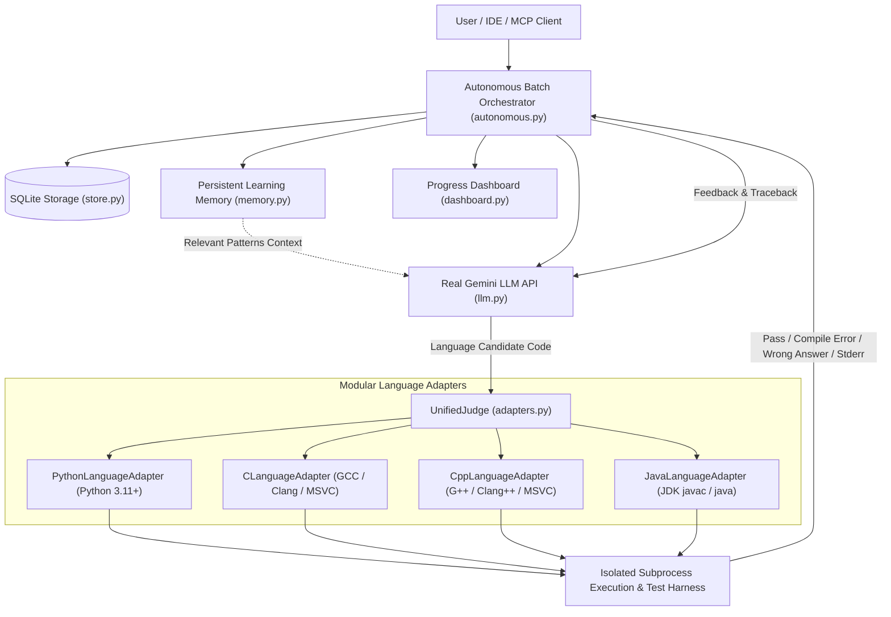

# LeetCode Agent 5.0 — Multi-Language Autonomous Solver & Personal Dashboard

An autonomous coding agent, multi-language execution engine, persistent algorithmic memory, personal progress dashboard, and Model Context Protocol (MCP) server that benchmarks, tracks, and autonomously solves Data Structures & Algorithms (DSA) problems in an iterative feedback loop.

Designed for your personal LeetCode account workflow (e.g. `jagadesh-02`, https://leetcode.com/u/jagadesh-02/), **Version 5.0** introduces a modular multi-language execution engine supporting **Python 3**, **C**, **C++**, and **Java**, a `UnifiedJudge` architecture, compiler detection for Windows/MSYS2 toolchains, language-specific progress tracking, autonomous batch solving with live pause/resume/stop controls, and 15 registered MCP tools.

---

## Architecture Overview



---

## Key Capabilities (Version 5.0)

1. **Multi-Language Execution Engine & UnifiedJudge**
   - Modular language adapter architecture supporting **Python 3**, **C**, **C++**, and **Java**.
   - Language-specific test harnesses (`harness.py`) preserving native interface conventions:
     - **C**: Pure C function interfaces (`int search(int* nums, int numsSize, int target)`) with explicit length parameters; no invented C++ classes.
     - **C++**: Standard LeetCode class syntax (`class Solution { public: int search(vector<int>& nums, int target) { ... } };`).
     - **Java**: Standard LeetCode class syntax (`class Solution { public int search(int[] nums, int target) { ... } }`).
     - **Python 3**: Both standard `class Solution` and standalone functions.
   - Captures compilation output (`compile_error`), execution output (`runtime_error`), stdout, stderr, and test pass counts.

2. **Windows & MSYS2 Compiler Auto-Detection**
   - Automatically probes and links GCC (`C:\msys64\ucrt64\bin\gcc.exe`), G++ (`C:\msys64\ucrt64\bin\g++.exe`), and JDK (`javac.exe`/`java.exe`).
   - Dynamically adds compiler directories to the process environment so dependent runtime DLLs are found without requiring global system reboots.
   - Accurately reports missing runtimes as `runtime_unavailable` without silent failure or false passes.

3. **Language-Specific Progress Tracking**
   - Progress is tracked independently per language in SQLite (`language_progress` table).
   - Solving a problem in Python does **not** mark it solved in Java, C, or C++, keeping pending problem queues open for practice in other languages.
   - Re-running the queue in the same language honors `skip_locally_verified=True` and advances to remaining problems.

4. **Real Gemini API Autonomous Solving Loop**
   - Uses real Google Gemini API models (`gemini-3.6-flash`, `gemini-1.5-flash`, etc.) via standard OpenAI-compatible endpoints.
   - Language-specific prompting (`get_system_prompt_for_language()`) instructs the model on correct syntax, types, and libraries.
   - Automated retry loop sends compiler diagnostics, tracebacks, and failed test cases back to Gemini for self-correction up to `max_attempts`.

5. **Autonomous Queue Controls & Checkpoints**
   - `start_autonomous_run`, `pause_autonomous_run`, `resume_autonomous_run`, and `stop_autonomous_run`.
   - Thread-safe worker lock ensures only one batch run executes concurrently.
   - Persists run metadata and problem queues in `autonomous_runs` and `autonomous_queue_items` for recovery after app restarts.
   - Configurable API request budget safeguards against unintended quota usage.

6. **Persistent Learning Memory**
   - Stores common DSA patterns and lessons (Two Pointers, Sliding Window, Dynamic Programming, Hash Maps, Prefix Sums, Linked Lists).
   - Injects relevant memory context into prompts before asking Gemini to solve problems.

7. **Personal LeetCode Dashboard & 15 MCP Tools**
   - Unified analytics tracking both manual CSV imports and verified official LeetCode verdicts with clear source attribution (`official_verdict` vs `csv_import`) and deduplication.

---

## Project Structure

```text
Leet_Code/
    main.py           # CLI entry point supporting single run and --autonomous mode
    autonomous.py     # Version 4.0/5.0 autonomous queue orchestrator & run controls
    adapters.py       # Version 5.0 UnifiedJudge and language adapters (Python, C, C++, Java)
    languages.py      # Version 5.0 compiler detection & PATH configuration
    harness.py        # Version 5.0 language-specific test harness builders
    memory.py         # Persistent learning memory retrieval & pattern seeds
    dashboard.py      # Unified dashboard engine, CSV parser & recommendations
    assistant.py      # Core workflow for single problem solving & complexity analysis
    llm.py            # Real OpenAI/Gemini LLM client and offline MockLLM
    judge.py          # Subprocess test runner with timeout enforcement
    problems.py       # Built-in problems dataset loader and difficulty filter
    store.py          # SQLite database storage (attempts, language_progress, verdicts, runs)
    prompts.py        # Language-aware system prompts, retry templates, code extraction
    problems.json     # 9 curated LeetCode problems (Easy, Medium, Hard)
    mcp_server.py     # FastMCP server exposing all 15 registered MCP tools over stdio
    leetcode_submissions_template.csv # CSV template for manual submission history
    tests/
        test_judge.py          # Tests for judge execution & timeouts
        test_problems.py       # Tests for problem dataset and filtering
        test_mock_llm.py       # Tests for offline MockLLM behavior
        test_mcp_server.py     # Tests for MCP server tools
        test_assistant.py      # Tests for single-problem assistant workflow
        test_dashboard.py      # Tests for dashboard analytics & deduplication
        test_autonomous.py     # Tests for autonomous queue, pause, resume, and stop
        test_languages.py      # Tests for compiler detection & language adapters
        test_lang_isolation.py # Tests for language-specific progress isolation
    requirements.txt  # Project dependencies
    .env.example      # Example environment configuration
    .gitignore        # Ignored files and directories
    README.md         # Documentation and guide
```

---

## Setup & Installation

### 1. Virtual Environment & Dependencies

```powershell
python -m venv .venv
.\.venv\Scripts\Activate.ps1
pip install -r requirements.txt
```

### 2. Environment Configuration

Copy `.env.example` to `.env`:

```powershell
Copy-Item .env.example .env
```

Configure your credentials in `.env` (never commit this file):

```ini
LLM_BASE_URL=https://generativelanguage.googleapis.com/v1beta/openai/
LLM_API_KEY=your_gemini_api_key_here
LLM_MODEL=gemini-3.6-flash
LLM_DELAY_SECONDS=4
JUDGE_TIMEOUT_SECONDS=10
```

### 3. Compiler Setup (Optional for C/C++/Java)

- **Python 3**: Requires Python 3.10+ (already provided by your virtual environment).
- **Java**: Install JDK 17+ and ensure `javac` and `java` are in your PATH.
- **C & C++ (Windows)**:
  - Install MSYS2 with UCRT64 toolchain: `pacman -S mingw-w64-ucrt-x86_64-gcc`.
  - The adapter automatically detects `C:\msys64\ucrt64\bin\gcc.exe` and `g++.exe`.

---

## CLI Usage Examples

### 1. Autonomous Batch Queue

Process up to 5 problems in the queue using **Python**:
```powershell
.\.venv\Scripts\python.exe main.py --autonomous --max-problems 5 --max-attempts 3
```

Process problems using **Java**:
```powershell
.\.venv\Scripts\python.exe main.py --autonomous --language java --max-problems 5
```

Process problems using **C++**:
```powershell
.\.venv\Scripts\python.exe main.py --autonomous --language cpp --max-problems 5 --budget 20
```

Process problems using **C**:
```powershell
.\.venv\Scripts\python.exe main.py --autonomous --language c --difficulty easy --max-problems 3
```

### 2. Offline Mock Mode (Testing without API Usage)

Run the autonomous queue offline using the built-in mock LLM:
```powershell
.\.venv\Scripts\python.exe main.py --autonomous --mock --max-problems 2
```

---

## All 15 Registered MCP Tools

The FastMCP server (`mcp_server.py`) provides 15 standard tools over `stdio`:

| # | Tool Name | Parameters | Description |
|---|---|---|---|
| 1 | **`list_problems`** | `difficulty` | Lists available built-in problems and local solved status. |
| 2 | **`get_problem`** | `problem_id` | Retrieves title, difficulty, description, signature, and example tests. |
| 3 | **`submit_solution`** | `problem_id, code` | Runs candidate code against test cases in the local judge. |
| 4 | **`get_progress`** | None | Returns summary of built-in problems, custom imports, and official verdicts. |
| 5 | **`import_problem`** | `url, title, difficulty, description, function_name, signature, example_tests` | Imports a user-supplied problem statement manually without scraping. |
| 6 | **`solve_problem`** | `problem_id, max_attempts` | Solves a single problem with real Gemini and formats copy-ready code. |
| 7 | **`record_verdict`** | `problem_id, verdict, runtime_ms, memory_mb, notes` | Logs official manual LeetCode submission benchmarks. |
| 8 | **`import_csv_submissions`** | `csv_path_or_content` | Imports manual LeetCode submission history from CSV. |
| 9 | **`get_dashboard`** | `username` | Computes dashboard analytics, recent submissions, and recommendations. |
| 10 | **`start_autonomous_run`** | `max_problems, max_attempts, difficulty, language, budget` | Launches an autonomous batch queue run in the background. |
| 11 | **`get_run_status`** | `run_id` | Checks live progress, counts, and queue items of an autonomous run. |
| 12 | **`pause_autonomous_run`** | `run_id` | Safely pauses an active run after the current attempt completes. |
| 13 | **`resume_autonomous_run`** | `run_id` | Resumes an autonomous run from its saved SQLite checkpoint. |
| 14 | **`stop_autonomous_run`** | `run_id` | Safely terminates an autonomous run. |
| 15 | **`get_learning_memory`** | `category, limit` | Retrieves persistent algorithmic patterns and code templates. |

### Configuring in Antigravity or MCP IDEs

Add to `mcp_config.json`:

```json
{
  "mcpServers": {
    "leetcode-agent": {
      "command": "D:\\Leet_code\\.venv\\Scripts\\python.exe",
      "args": [
        "D:\\Leet_code\\mcp_server.py"
      ],
      "cwd": "D:\\Leet_code"
    }
  }
}
```

---

## Running Automated Tests

Run the full automated test suite (all 45 tests):

```powershell
.\.venv\Scripts\python.exe -m pytest -v
```

All tests execute against isolated temporary SQLite databases (`tmp_path`), leaving your actual `progress.db` and official submission history intact.

---

## Important Notices & Current Limitations

> [!NOTE]
> **Problem-Specific Test Harnesses**:
> Automated multi-language evaluation depends on having a corresponding test harness for each problem's input/output types. While Python supports dynamic argument unpacking for arbitrary JSON inputs, compiled languages (C, C++, Java) require type-specific test harness generators (such as those in `harness.py`). If a problem requires complex custom data structures (e.g. linked lists or binary tree nodes) in compiled languages, a tailored harness generator must be provided.

> [!IMPORTANT]
> **Local Verification $\neq$ Official LeetCode Acceptance**:
> - **`locally_verified`**: Indicates that candidate code passed the local sample unit test cases inside the isolated judge. It does **not** constitute official acceptance by LeetCode or guarantee passing LeetCode's comprehensive hidden test cases or strict memory constraints.
> - **Official Accepted**: Recorded only when you manually submit your solution on LeetCode and log the result via `record_verdict`.

> [!WARNING]
> **Subprocess Isolation vs. Security Sandboxing**:
> The local judge executes code inside isolated temporary subprocesses with execution timeouts (`JUDGE_TIMEOUT_SECONDS = 10`) and directory cleanups. Subprocess execution limits hanging processes and accidental side effects, but it is **not** an OS-level virtualization or secure container sandbox. Do not run untrusted or adversarial arbitrary code.

> [!NOTE]
> **Zero Web Scraping & Zero Automated Submissions**:
> In compliance with LeetCode's Terms of Service:
> - The agent **never** requests or stores LeetCode passwords, cookies, or session tokens.
> - The agent **never** scrapes, crawls, or makes automated HTTP calls to `leetcode.com`.
> - The agent **never** submits code to external sites automatically. All problem imports and submission records are provided and confirmed manually by the user.
